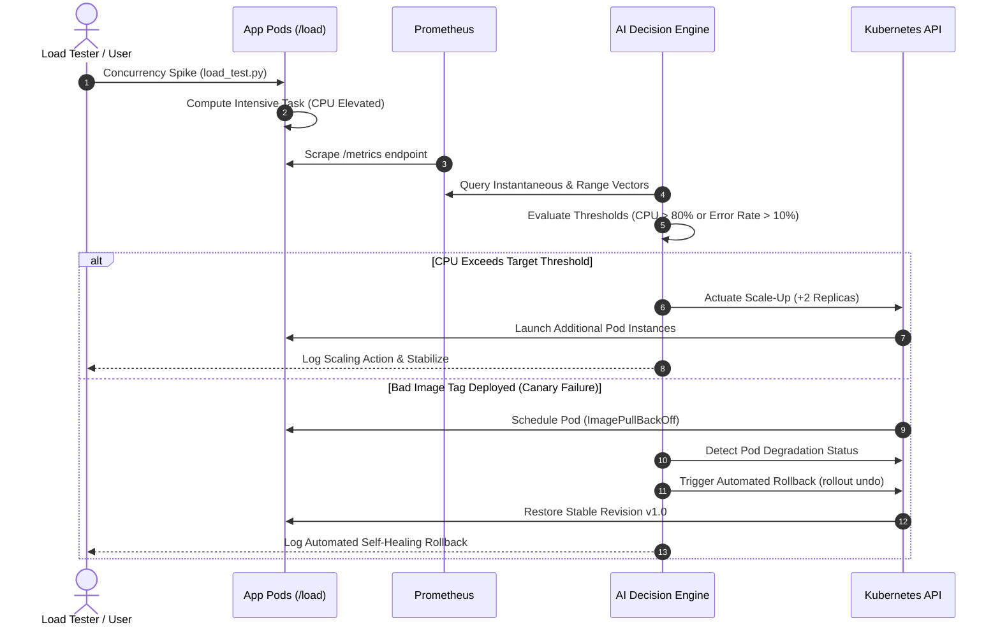

# Intelligent Autonomous DevOps Deployment Platform

[](https://kubernetes.io/)
[](https://www.docker.com/)
[](https://www.ansible.com/)
[](https://www.python.org/)
[](https://prometheus.io/)
[](https://grafana.com/)
[](https://helm.sh/)
[](LICENSE)
[](#)

---

## Project Team

This project was conceived, designed, and implemented as part of the Project-Based Learning (PBL) DevOps curriculum:

| Name | University Seat Number (USN) | Role / Specialization |
| :--- | :--- | :--- |
| **Hari Charan V** | `1RV25MC037` | Autonomous Control Loops, Infrastructure Automation & Testing |
| **M Srikanth** | `1RV25MC053` | Kubernetes Orchestration, Helm Charts & Observability |
| **Anurag R Swamy** | `1RV25MC016` | Microservices Architecture, Container Security & CI/CD Pipelines |

---

## Executive Summary & System Description

The **Intelligent Autonomous DevOps Deployment Platform** is a next-generation closed-loop infrastructure orchestration system. Traditional DevOps pipelines rely heavily on static alerts and manual human intervention when production anomalies, traffic spikes, or bad deployments occur. This platform shifts operational paradigms from **reactive monitoring** to **autonomous proactive control**.

By integrating **Kubernetes**, **Ansible**, **Prometheus telemetry**, and an **AI Decision Engine**, the platform observes runtime service telemetry in real time, computes statistical anomaly scores, and takes corrective actions automatically without human overhead:
- **Dynamic Horizontal Autoscaling**: Predictive adjustment of container pod replicas in response to simulated or organic traffic spikes.
- **Canary Anomaly Detection**: Identification of deployment anomalies (such as image pull failures, high error rates, or crashing containers).
- **Self-Healing Rollbacks**: Immediate, automated rollback to the last verified healthy release upon canary failure detection.
- **Continuous Observability**: End-to-end metrics scraping via Prometheus with real-time visualization dashboards in Grafana.

---

## System Architecture

The platform architecture follows an **OODA Loop** (*Observe, Orient, Decide, Act*) model where infrastructure state is constantly reconciled against target operational baselines.

```mermaid
flowchart TD
    subgraph DeveloperWorkstation ["Developer & Automation Layer"]
        DEV["DevOps Engineers"] -->|Git Commit / Push| SCRIPT_DEMO["demo.sh / setup.sh"]
        DEV -->|Config & Thresholds| AI_CFG["ai-engine/config.yaml"]
    end

    subgraph CI_CD ["Build & Orchestration Layer"]
        SCRIPT_DEMO -->|Build & Tag| DOCKER_BUILD["Docker Multi-Stage Build"]
        DOCKER_BUILD -->|Image Load| MK_LOAD["Minikube Container Cache"]
        SCRIPT_DEMO -->|Execute Playbooks| ANSIBLE_ENGINE["Ansible Automation Engine"]
    end

    subgraph K8S_CLUSTER ["Kubernetes Cluster (Namespace: devops-platform)"]
        ANSIBLE_ENGINE -->|Apply Manifests| K8S_API["Kubernetes API Server"]
        K8S_API --> DEP["Deployment: devops-demo-app"]
        DEP --> POD1["App Pod 1"]
        DEP --> POD2["App Pod 2"]
        DEP -.->|Dynamic Scale| PODN["App Pod N (HPA Scaled)"]
        SVC["Service: devops-demo-app (NodePort 30080)"] --> POD1
        SVC --> POD2
        SVC --> PODN
        HPA["Horizontal Pod Autoscaler"] -->|Scale Target: CPU 50%| DEP
    end

    subgraph OBSERVABILITY ["Telemetry & Monitoring (Namespace: monitoring)"]
        PROM["Prometheus Server"] -->|Scrape /metrics (15s)| POD1
        PROM -->|Scrape /metrics (15s)| POD2
        GRAFANA["Grafana Dashboards"] -->|Query PromQL| PROM
    end

    subgraph AI_DECISION_ENGINE ["Autonomous AI Engine (OODA Loop)"]
        PROM -->|Query CPU, Latency, Error Rates| OBSERVER["1. OBSERVE (Metrics Scraper)"]
        OBSERVER --> ORIENT["2. ORIENT (Statistical Anomaly Detection)"]
        ORIENT --> DECIDER["3. DECIDE (Policy Matrix & Healing Rules)"]
        DECIDER --> ACTUATOR["4. ACT (Autonomous Actuator)"]
        ACTUATOR -->|Rollback Execution| ANSIBLE_ENGINE
        ACTUATOR -->|Replica Tuning| K8S_API
    end

    classDef k8s fill:#326CE5,stroke:#fff,stroke-width:1px,color:#fff;
    classDef ai fill:#673AB7,stroke:#fff,stroke-width:1px,color:#fff;
    classDef obs fill:#E6522C,stroke:#fff,stroke-width:1px,color:#fff;
    class K8S_CLUSTER,K8S_API,DEP,POD1,POD2,PODN,HPA,SVC k8s;
    class AI_DECISION_ENGINE,OBSERVER,ORIENT,DECIDER,ACTUATOR ai;
    class OBSERVABILITY,PROM,GRAFANA obs;
```

### Self-Healing & Scaling Sequence



---

## Technology Stack

| Domain | Technology | Version | Purpose |
| :--- | :--- | :--- | :--- |
| **Containerization** | Docker Engine | 26.0+ | Multi-stage image build, minimal runtime attack surface, cgroup isolation |
| **Container Orchestration** | Kubernetes / Minikube | 1.30+ / 1.39+ | Pod scheduling, service discovery, horizontal scaling, self-healing |
| **Configuration Management** | Ansible Core | 2.16+ | Declarative rollout playbooks, inventory management, rollback automation |
| **Microservice Backend** | Python / Flask | 3.12 / 3.0+ | Lightweight REST service, telemetry exposition, load generation endpoint |
| **Observability & Metrics** | Prometheus Community | v2.50+ | Time-series metrics collection, alerts, PromQL scraping |
| **Dashboards & Telemetry** | Grafana | v10.4+ | Real-time operations dashboards, visualization panels |
| **Package Management** | Helm 3 | v3.14+ | Standardized package deployment for Prometheus and Grafana operator stacks |
| **Security Scanning** | Aqua Trivy | v0.50+ | Static vulnerability analysis of base OS packages and application dependencies |
| **Testing & Verification** | Python ThreadPool | 3.12 | Concurrent HTTP load generation, latency percentile calculation (p50/p95/p99) |

---

## Prerequisites

Before setting up the environment, verify that your host system satisfies the following minimum hardware and operating system requirements:

- **Operating System**: Ubuntu 22.04 LTS / Ubuntu 24.04 LTS (or Debian-derived Linux)
- **CPU**: Minimum 4 Physical Cores (2 allocated to Minikube)
- **RAM**: Minimum 8 GB Physical Memory (4096 MB allocated to Minikube)
- **Storage**: 20 GB free disk space
- **Virtualization**: Hardware virtualization enabled in BIOS (VT-x / AMD-V)
- **Access Privileges**: `sudo` permissions for package installation and Docker group membership

---

## Quick Start Guide

Follow these sequential steps to clone, initialize, and verify the platform.

### Step 1: Clone Repository & Enter Directory
```bash
git clone https://github.com/haricharanv/PBL_DEVOPS.git
cd PBL_DEVOPS
```

### Step 2: Run Full Automated Environment Setup
The setup script detects your distribution, validates all 8 prerequisites, provisions the Minikube cluster with necessary addons, and deploys Prometheus and Grafana via Helm:
```bash
# Preview checks in dry-run mode
./scripts/setup.sh --dry-run

# Execute full automated setup
./scripts/setup.sh
```

### Step 3: Run the End-to-End Showcase Demo
Execute the interactive demonstration script that walks through building the image, deploying via Ansible, testing autoscaling under load, and validating self-healing rollback:
```bash
./scripts/demo.sh
```

### Step 4: Run Concurrent Load Testing Separately
To evaluate cluster autoscaling independently under customizable load intensities:
```bash
python3 scripts/load_test.py --url http://localhost:8080/load --duration 30 --concurrency 10
```

### Step 5: Clean Up Environment Resources
When testing is complete, safely purge test workloads and optionally stop the cluster:
```bash
./scripts/cleanup.sh
```

---

## Project Structure

```
PBL_DEVOPS/
├── README.md                      # Primary project documentation and specifications
├── .gitignore                     # Git exclusion rules for Python, K8s, Docker, and IDEs
├── ai-engine/                     # Closed-loop autonomous decision system
│   ├── config.yaml                # AI threshold rules, scaling limits, and interval configs
│   ├── main.py                    # Core OODA decision controller script
│   └── models/                    # Anomaly detection model weights and serialized artifacts
├── ansible/                       # Ansible playbooks and inventories
│   ├── inventory/
│   │   └── hosts.ini              # Target environment hosts inventory
│   ├── playbooks/
│   │   ├── deploy.yml             # Declarative zero-downtime deployment playbook
│   │   └── rollback.yml           # Automated release rollback playbook
│   └── roles/                     # Modular Ansible task roles
├── app/                           # Microservice source code
│   ├── app.py                     # Flask microservice with /metrics, /health, /load endpoints
│   ├── requirements.txt           # Python application dependencies
│   └── tests/                     # Unit and integration test suites
├── docker/                        # Containerization assets
│   └── Dockerfile                 # Multi-stage, secure non-root Docker build specification
├── docs/                          # Documentation resources and architecture assets
│   └── screenshots/               # Demonstration captures and visualization artifacts
├── kubernetes/                    # Declarative Kubernetes YAML manifests
│   └── deployment.yaml            # Deployment, Service (NodePort), and HPA manifests
├── monitoring/                    # Observability specifications
│   ├── grafana/
│   │   └── dashboards/            # Pre-configured Grafana dashboard JSON models
│   └── prometheus/                # Custom Prometheus scraping and alerting rules
└── scripts/                       # Operational utility and automation scripts
    ├── setup.sh                   # Environment validation, Minikube bootstrap, Helm installer
    ├── demo.sh                    # End-to-end interactive platform verification showcase
    ├── load_test.py               # Concurrent multi-threaded load generator with progress UI
    └── cleanup.sh                 # Resource teardown and cleanup automation
```

---

## Module Descriptions

- [**scripts/setup.sh**](file:///home/haricharanv/PBL_DEVOPS/scripts/setup.sh): Complete environment setup script. Detects OS and CPU architecture, verifies and installs 8 core development tools (`docker`, `minikube`, `kubectl`, `ansible`, `python3`, `pip`, `helm`, `trivy`), provisions a 2-CPU / 4096MB Minikube cluster, enables essential addons (`metrics-server`, `dashboard`, `ingress`), installs Prometheus + Grafana via Helm, and creates the `devops-platform` namespace.
- [**scripts/demo.sh**](file:///home/haricharanv/PBL_DEVOPS/scripts/demo.sh): End-to-end demonstration harness. Automates building the local container, loading it into Minikube, deploying via Ansible, verifying pod readiness, triggering HPA autoscaling with `load_test.py`, injecting a faulty canary image to trigger an automated self-healing rollback, and running the AI Decision Engine telemetry loop.
- [**scripts/load_test.py**](file:///home/haricharanv/PBL_DEVOPS/scripts/load_test.py): Concurrent load-testing engine using Python's `ThreadPoolExecutor`. Generates dynamic sinusoidal traffic spikes against `/load`, computes p50/p95/p99 latency distributions, displays an in-place terminal progress bar, and outputs a formatted performance audit report.
- [**scripts/cleanup.sh**](file:///home/haricharanv/PBL_DEVOPS/scripts/cleanup.sh): Resource reclamation utility. Purges all deployments, services, pods, and ingress rules in `devops-platform`, removes local and cached Docker images, terminates port-forward processes, and optionally stops or deletes the Minikube cluster.
- [**ai-engine/config.yaml**](file:///home/haricharanv/PBL_DEVOPS/ai-engine/config.yaml): Operational policy specification for the AI engine, defining CPU high/low watermarks, p95 latency thresholds, pod restart limits, and cooldown intervals.

---

## API Endpoints Documentation

The microservice exposes standard REST endpoints for operations, telemetry scraping, and synthetic load testing:

| Method | Endpoint | Query Parameters | Description | Sample Output |
| :--- | :--- | :--- | :--- | :--- |
| `GET` | `/` | None | Primary service identification and version check | `{"message":"...","service":"devops-demo-app","status":"online","version":"v1.0"}` |
| `GET` | `/health` | None | Liveness and readiness probe endpoint | `{"status":"healthy","timestamp":1700000000.0,"version":"v1.0"}` |
| `GET` | `/metrics` | None | Prometheus-formatted metrics scrape endpoint | Text/plain Prometheus metric vectors (`http_requests_total`, etc.) |
| `GET` | `/load` | `intensity` (int, default: 1) | Computes mathematical workloads to drive CPU usage and trigger HPA scaling | `{"duration_ms":38.45,"intensity":8,"status":"load_completed"}` |
| `GET` | `/version` | None | Returns active deployed release tag | `{"version":"v1.0"}` |

---

## AI Decision Engine & Closed-Loop Control

The **AI Decision Engine** functions as an autonomous governor adhering to the classic OODA control loop:

```
┌────────────────────────────────────────────────────────┐
│                   OODA CONTROL CYCLE                   │
├─────────────────┬──────────────────────────────────────┤
│ 1. OBSERVE      │ Scrapes Prometheus metrics: CPU,     │
│                 │ memory, p95 latency, error rates     │
├─────────────────┼──────────────────────────────────────┤
│ 2. ORIENT       │ Evaluates values against statistical │
│                 │ baselines and anomaly drift models   │
├─────────────────┼──────────────────────────────────────┤
│ 3. DECIDE       │ Formulates action: SCALE_UP,         │
│                 │ SCALE_DOWN, ROLLBACK, or STABILIZE   │
├─────────────────┼──────────────────────────────────────┤
│ 4. ACT          │ Triggers Kubernetes API / Ansible    │
│                 │ playbooks to enforce desired state   │
└─────────────────┴──────────────────────────────────────┘
```

### Policy Rules Matrix

```yaml
thresholds:
  cpu_high: 80%           # Trigger SCALE_UP (+2 replicas)
  cpu_low: 20%            # Trigger SCALE_DOWN (-1 replica)
  latency_p95_max: 1.0s   # Trigger latency alert / scaling
  error_rate_high: 10%    # Trigger rollback investigation
  pod_restart_max: 3      # Detect CrashLoopBackOff and remediate
scaling:
  min_replicas: 2
  max_replicas: 10
  cooldown_period: 300s   # Prevents flapping / thrashing
```

---

## Demonstration Instructions

Run the automated walkthrough via `demo.sh`. The script proceeds through 9 sequential stages:

```bash
# Run interactively (pauses between stages with explanations)
./scripts/demo.sh

# Or run non-interactively in automated test pipelines
./scripts/demo.sh --non-interactive --load-duration 25 --load-concurrency 8
```

### What You Will Observe:
1. **Docker Multi-Stage Build**: Compiles Python bytecode and builds lightweight runner image `devops-demo-app:v1.0`.
2. **Minikube Image Ingestion**: Direct container transfer without requiring external cloud registries.
3. **Ansible Playbook Execution**: Automated deployment of manifests into namespace `devops-platform`.
4. **Readiness Probe Validation**: Verification that container health checks pass before routing traffic.
5. **Autoscaling In Action**: `load_test.py` sends hundreds of concurrent requests, driving CPU above 50% and triggering HPA to spawn additional replicas.
6. **Fault Injection & Rollback**: A non-existent image (`devops-demo-app:v999.invalid`) is deployed. The system catches `ImagePullBackOff`, halts rollout, and executes `kubectl rollout undo` / Ansible rollback.
7. **AI Decision Logs**: Real-time evaluation of Prometheus telemetry displaying decision reasoning.

---

## Visualizations & Screenshots

Place captured verification screenshots in [`docs/screenshots/`](file:///home/haricharanv/PBL_DEVOPS/docs/screenshots/):

| View | Screenshot Reference | Description |
| :--- | :--- | :--- |
| **Cluster Architecture** | `docs/screenshots/architecture_overview.png` | Topology of Minikube nodes, pods, and ingress controllers |
| **Grafana Monitoring Dashboard** | `docs/screenshots/grafana_dashboard.png` | Live CPU, memory consumption, and request throughput graphs |
| **HPA Autoscaling Event** | `docs/screenshots/autoscaling_demo.png` | Real-time terminal output showing replica count scaling from 2 to 6 |
| **Automated Rollback** | `docs/screenshots/automated_rollback.png` | Detection of faulty canary pod and immediate rollout undo |
| **Load Test Report** | `docs/screenshots/load_test_report.png` | Terminal summary table showing request throughput and latency percentiles |

---

## Troubleshooting Guide

### 1. Docker Daemon Socket Permission Denied
- **Symptom**: `permission denied while trying to connect to the Docker daemon socket`
- **Resolution**:
  ```bash
  sudo usermod -aG docker $USER
  newgrp docker
  ```

### 2. Minikube Driver Compatibility
- **Symptom**: `Exiting due to DRV_AS_ROOT: The "docker" driver should not be used with root privileges.`
- **Resolution**: Run `minikube start` as a regular non-root user who belongs to the `docker` group.

### 3. Horizontal Pod Autoscaler Shows `<unknown>/50%`
- **Symptom**: `kubectl get hpa` shows `<unknown>` for CPU utilization.
- **Cause**: `metrics-server` addon is still starting up or collecting its initial 60-second metrics window.
- **Resolution**:
  ```bash
  minikube addons enable metrics-server
  kubectl get deployment metrics-server -n kube-system
  # Wait approximately 60 seconds for metrics collection cycle to settle
  ```

### 4. Port Forward Collisions
- **Symptom**: `Unable to listen on port 8080: Listen: address already in use`
- **Resolution**:
  ```bash
  pkill -f "kubectl port-forward"
  # Or find and terminate the process holding the port:
  lsof -i :8080 | awk 'NR>1 {print $2}' | xargs -r kill -9
  ```

---

## Contributing Guidelines

1. **Feature Branches**: Create a dedicated branch for all changes:
   ```bash
   git checkout -b feature/your-feature-name
   ```
2. **Pre-Commit Checks**:
   - Ensure all shell scripts pass syntax checks (`bash -n scripts/*.sh`).
   - Run Python linting and unit tests (`pytest app/tests`).
3. **Pull Request Protocol**:
   - Provide a clear summary of modifications, affected components, and test evidence.

---

## License

This project is licensed under the terms of the **MIT License**.

```
Copyright (c) 2026 Hari Charan V, M Srikanth, Anurag R Swamy

Permission is hereby granted, free of charge, to any person obtaining a copy
of this software and associated documentation files (the "Software"), to deal
in the Software without restriction, including without limitation the rights
to use, copy, modify, merge, publish, distribute, sublicense, and/or sell
copies of the Software, and to permit persons to whom the Software is
furnished to do so, subject to the following conditions:

The above copyright notice and this permission notice shall be included in all
copies or substantial portions of the Software.

THE SOFTWARE IS PROVIDED "AS IS", WITHOUT WARRANTY OF ANY KIND, EXPRESS OR
IMPLIED, INCLUDING BUT NOT LIMITED TO THE WARRANTIES OF MERCHANTABILITY,
FITNESS FOR A PARTICULAR PURPOSE AND NONINFRINGEMENT. IN NO EVENT SHALL THE
AUTHORS OR COPYRIGHT HOLDERS BE LIABLE FOR ANY CLAIM, DAMAGES OR OTHER
LIABILITY, WHETHER IN AN ACTION OF CONTRACT, TORT OR OTHERWISE, ARISING FROM,
OUT OF OR IN CONNECTION WITH THE SOFTWARE OR THE USE OR OTHER DEALINGS IN THE
SOFTWARE.
```
